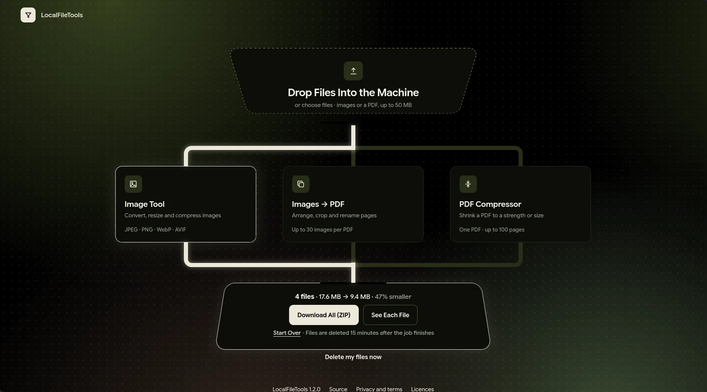
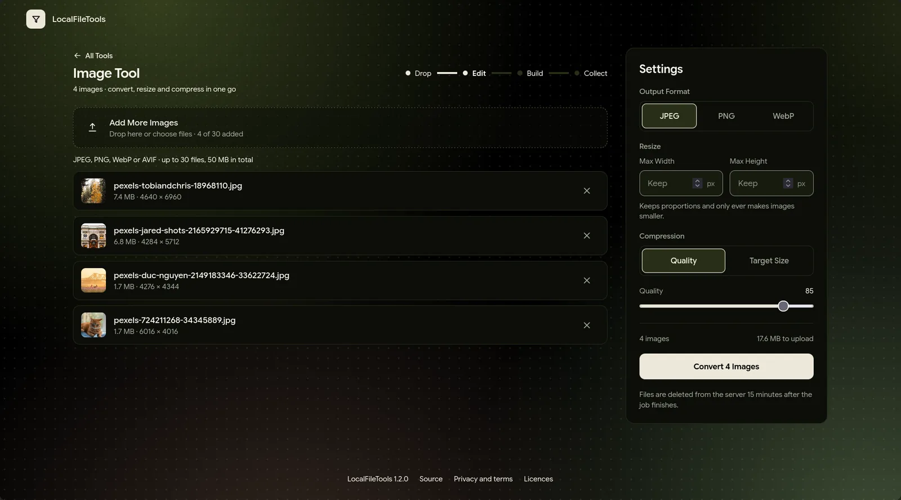
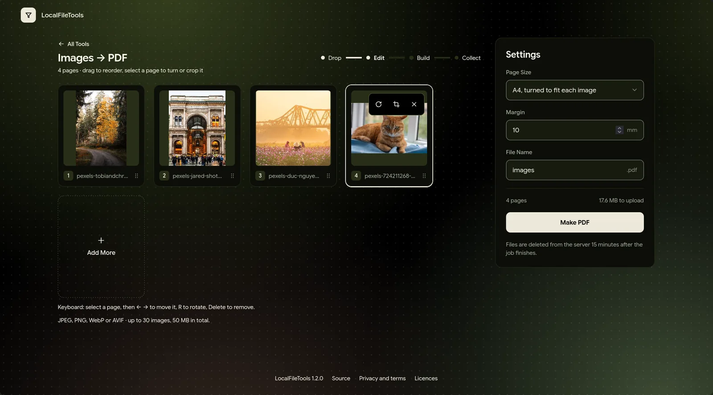

<div align="center">

# LocalFileTools

**Self-hosted, privacy-first image and PDF converter. Your files never leave your server.**

[](https://tools.foursquare16labs.in)
[](https://github.com/Foursquare16/LocalFileTools/tags)
[](https://github.com/Foursquare16/LocalFileTools/pkgs/container/localfiletools)
[](LICENSE)
<br>


[**Try it live**](https://tools.foursquare16labs.in) · [Run your own](#quick-start) · [How it works](docs/architecture.md)



</div>

A self-hosted file converter. It runs in Docker Compose on your own server and needs no login. Files are processed
by local libraries (Pillow, img2pdf, pikepdf, Ghostscript); nothing is sent to an external conversion service.

## Tools

| Tool | What it does | Accepts | Produces |
|---|---|---|---|
| Image tool | Convert, resize (keeps proportions, only shrinks), compress to a quality or a best-effort target size per image | JPEG, PNG, WebP, AVIF | JPEG, PNG or WebP, one file per input |
| Images → PDF | Put several images into one PDF; reorder (drag or keyboard), rotate and crop them; A4 or image-sized pages; margin; choose the file name | JPEG, PNG, WebP, AVIF | One PDF |
| PDF compressor | Make a PDF smaller with a strength (low, medium, high) or a target size; returns the smallest result that beats the original | One PDF | One PDF |

| Image tool | Images → PDF |
|---|---|
|  |  |

Files are checked by their content, not their extension. Target sizes work for JPEG and WebP only (PNG has no quality
setting) and are best effort: if a target can't be reached you get the smallest result and its real size. The PDF
compressor keeps text and vectors (pages are never turned into images) and does not accept encrypted, signed or
fillable-form PDFs.

## Privacy

Uploaded files are stored and processed only on your server and are deleted about 15 minutes after the job finishes
(there is a cleanup pass every minute). They are never backed up. The page loads no analytics, remote fonts or
third-party scripts.

If you publish it through a Cloudflare Tunnel, as the deployment guide does, Cloudflare terminates TLS and can
decrypt the traffic, including your uploads and downloads, as it passes through.

## Limits

All limits are set in `.env` (copied from `.env.example`). The values below are the defaults.

| Limit | Default | `.env` variable |
|---|---|---|
| Queued jobs | 20 | `LFT_MAX_QUEUED` |
| Upload size, all files of one job together | 50 MB | `LFT_MAX_UPLOAD_MB` |
| Files per job | 30 | `LFT_MAX_FILES` |
| Image size | 60 megapixels per image | `LFT_MAX_IMAGE_MP` |
| PDF length | 100 pages | `LFT_MAX_PDF_PAGES` |
| Processing time per job | 300 seconds | `LFT_JOB_TIMEOUT_SECONDS` |
| Space for uploads and results (jobs volume) | 2048 MB | `LFT_DISK_BUDGET_MB` |
| Keep finished jobs for | 900 seconds | `LFT_RETENTION_SECONDS` |
| Cleanup interval | 60 seconds | `LFT_CLEANUP_INTERVAL_SECONDS` |

Fixed, not in `.env`:

- One job is processed at a time.
- The worker container is limited to 2 GB RAM and 2 CPUs, the web container to 512 MB RAM (`compose.yaml`).
- The web page checks the default 30 files and 50 MB itself before uploading. Raising `LFT_MAX_FILES` or
  `LFT_MAX_UPLOAD_MB` takes effect on the server only, and Cloudflare rejects request bodies over 100 MB on its
  Free and Pro plans.

## Quick start

Needs Docker with Compose and git. This builds the image from source; to run the published image instead, see
[docs/update-rollback.md](docs/update-rollback.md).

```bash
git clone https://github.com/Foursquare16/LocalFileTools.git
```

```bash
cd LocalFileTools
```

```bash
cp .env.example .env
```

```bash
docker compose up -d --build
```

The app now listens on `http://127.0.0.1:8080`, on the server only. Open it in a browser on the server itself,
or publish it with a Cloudflare Tunnel as described in [docs/deploy.md](docs/deploy.md). The site works over HTTPS
from other machines; over plain HTTP on your LAN only with `LFT_LAN_HOST` set (deploy guide, case C).

## Public use

Anyone who opens the app gets an anonymous cookie named `session`, valid for 7 days. A job can be read, downloaded
or deleted only by the browser that created it. The "Delete my files now" button deletes all jobs of that browser at
once. The server keeps only a hash of the cookie's token.

The queue holds 20 jobs, and the job status shows its place in the queue.

To close the service to everyone, and open it again:

```bash
docker compose exec web python -m app.cli close
```

```bash
docker compose exec web python -m app.cli open
```

Visitors see a "service closed" page while it is closed. Jobs already in the queue still run. No restart is needed.

## Tests

The backend tests generate their images and PDFs at run time. The Ghostscript tests are skipped when `gs` is not
installed.

```bash
cd backend && uv run pytest
```

The frontend has no unit tests; the build type-checks it:

```bash
cd frontend && npm ci && npm run build
```

## Documentation

- [Architecture](docs/architecture.md): containers, storage, job lifecycle, security boundaries
- [Deploying](docs/deploy.md): on a home server beside Navidrome, behind a Cloudflare Tunnel
- [Updating and rolling back](docs/update-rollback.md)
- [Backup and restore](docs/backup.md)
- [Contributing](CONTRIBUTING.md)

## Licence

AGPL-3.0, see [LICENSE](LICENSE). Third-party components and their licences are listed in [NOTICE](NOTICE).
If you run a modified version for other people, the AGPL requires you to offer them its source; the page footer
links to the source code.
